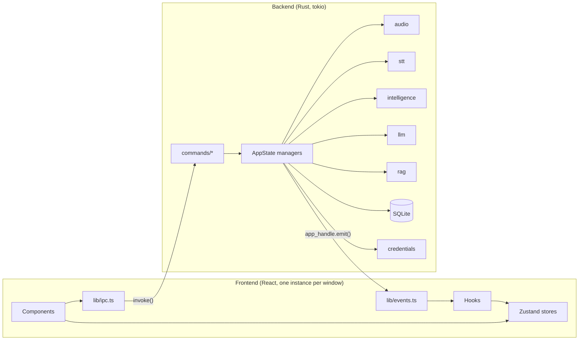
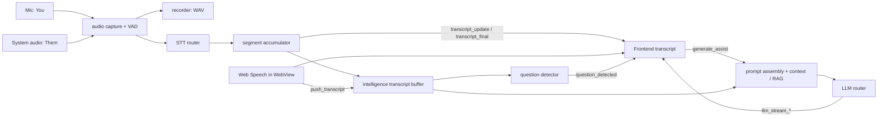

# NexQ Architecture

This document explains how NexQ is put together, for contributors who want to find their way around the code. For setup and day-to-day commands, see [DEVELOPMENT.md](DEVELOPMENT.md).

## Overview

NexQ is a [Tauri 2](https://v2.tauri.app/) desktop app made of two processes:

- **Rust backend** (`src-tauri/src/`, tokio async runtime): audio capture, speech-to-text, LLM streaming, prompt assembly, RAG, translation, SQLite, credentials, tray and updater.
- **React frontend** (`src/`, React 18 + TypeScript + Vite, rendered in WebView2 on Windows and WKWebView on macOS): all UI, state in Zustand stores, and the Web Speech engine.

They talk over Tauri IPC: the frontend **invokes commands** and the backend **emits events**.

## Windows

Defined in `src-tauri/tauri.conf.json`, both loading the same frontend bundle:

| Label | Size | Purpose |
|---|---|---|
| `launcher` | 900x650 | Main window: meeting list and details, settings, context, setup |
| `overlay` | 500x700 | In-meeting window: always on top, transparent, transcript and AI panel |

Each window runs its **own JavaScript context with its own store instances**. State that must be shared crosses windows through backend events (for example `meeting_started`, `nexq:meeting_ended`) and through settings persisted by the backend. A detached Dev Log window (`?view=devlog`) can also be opened from the overlay. A system tray (`src-tauri/src/tray/`) controls meetings and windows.

## The meeting pipeline

1. **Audio capture** (`src-tauri/src/audio/`). Two independent parties: the microphone ("You", `mic_capture.rs`) and system output ("Them", `system_capture.rs`, a cpal loopback stream; WASAPI on Windows). Audio is resampled (`resampler.rs`), gated by voice activity detection (`vad.rs`), optionally recorded to WAV (`recorder.rs`) and measured for level meters (`audio_level` events). Each party has its own mute flag in `AppState`; muting stops STT but not recording or levels.
2. **Speech-to-text** (`src-tauri/src/stt/`). Providers implement the `STTProvider` trait (`provider.rs`) and are selected per party by the router in `stt/mod.rs`. Local engines (Whisper.cpp, Sherpa-ONNX, ORT Streaming, Parakeet TDT, Windows Speech) and cloud engines (Deepgram, Groq Whisper, Whisper API, Azure Speech) live here; model downloads are handled by `stt/local_engines/`. **Web Speech** is the exception: it runs in the frontend (`src/hooks/useSpeechRecognition.ts`) and sends results to the backend with the `push_transcript` command.
3. **Segmentation.** `segment_accumulator.rs` merges partial results into paragraphs using the configurable pause threshold, then the backend emits `transcript_update` (interim) and `transcript_final` events and pushes final segments into the intelligence engine.
4. **Intelligence** (`src-tauri/src/intelligence/`). `transcript_buffer.rs` keeps the rolling transcript; `question_detector.rs` emits `question_detected`; `context_scope.rs` resolves which part of the transcript an action uses; `context_builder.rs` and `prompt_templates.rs` assemble the prompt from the transcript, the active scenario (pushed by the frontend with `set_active_scenario`), loaded documents and RAG results. User actions (Assist, What to Say, Recap, Ask, summaries, action items and so on) all go through the `generate_assist` command.
5. **LLM** (`src-tauri/src/llm/`). Providers implement a common streaming trait (`provider.rs`) behind a router (`llm/mod.rs`): OpenAI-compatible endpoints (`openai_compat.rs`, used for OpenAI, Groq, LM Studio and OpenRouter), Anthropic, Gemini (plus `gemini_cache.rs` for Gemini Context Cache), Ollama, and custom endpoints (`custom.rs`, SSE or NDJSON). Tokens stream to the UI as `llm_stream_start`, `llm_stream_token`, `llm_stream_thinking`, `llm_stream_sources`, `llm_stream_end` and `llm_stream_error`, scoped by request id so concurrent requests and cancellation (`cancel_generation`) stay separate.
6. **Claude CLI provider** (`src-tauri/src/llm/cli_agent/`). Uses the user's own Claude subscription by running the local `claude` CLI as a persistent hidden child process speaking the stream-json protocol (`session.rs`, `protocol.rs`), with tools disabled (`command.rs`). `manager.rs` keeps warm per-meeting sessions and sends only transcript deltas; `detect.rs` finds the CLI and checks the login; `routing.rs` decides when to fall back. Status is reported through `agent_session_status` and `agent_fallback` events.

## Supporting subsystems

| Module | Responsibility |
|---|---|
| `rag/` | Local RAG: `chunker.rs`, embeddings through Ollama (`embedder.rs`), SQLite FTS5 keyword search (`fts_store.rs`), cosine-similarity vectors (`vector_store.rs`), hybrid `search.rs`, and live transcript indexing. Progress is reported with `rag_index_progress` and never blocks the UI. |
| `context/` | Loading context documents (PDF with a fallback extractor, DOCX, TXT, MD) and token counting. |
| `translation/` | Translation router: DeepL, Google, Microsoft, LLM-based, and offline OPUS-MT models. |
| `db/` | SQLite via rusqlite (`nexq.db`), with versioned migrations in `migrations.rs`. Tables cover meetings, transcript segments, speakers, bookmarks, action items, topic sections, translations, meeting chat, context resources and RAG chunks/embeddings. |
| `credentials/` | API keys in the OS credential store: Windows Credential Manager (`windows_cred.rs`); macOS Keychain (`macos_keychain.rs`). Keys never go into settings files or the database. |
| `commands/` | One module per feature area exposing `#[command]` functions; all are registered in `lib.rs`. |
| `tray/` | Tray icon, menu and tooltip state. |
| `commands/updater_commands.rs` | Discord-style updater: background download, Ed25519-verified install on quit, never during a meeting. |
| `commands/stealth_commands.rs` | Stealth mode: keeps every NexQ window out of screen capture (`WDA_EXCLUDEFROMCAPTURE` on Windows, `NSWindowSharingNone` on macOS). |

### AppState

`src-tauri/src/state.rs` defines `AppState`, managed by Tauri and injected into commands as `State<'_, AppState>`. It holds one slot per subsystem (`database`, `audio`, `stt`, `llm`, `intelligence`, `context`, `credentials`, `rag`, `translation`, models and more), mostly as `Arc<Mutex<...>>`, plus lock-free atomics for hot paths such as per-party mute flags and the pause threshold. Managers are created during setup in `lib.rs`; most initialization failures are logged and leave the slot empty rather than crashing the app.

## Frontend

| Path | Contents |
|---|---|
| `src/lib/types.ts` | Every TypeScript type. **Must mirror the Rust structs**: a mismatch silently breaks serialization. |
| `src/lib/ipc.ts` | Typed wrapper for every Tauri command. Components never call `invoke()` directly. |
| `src/lib/events.ts` | Typed listeners for every backend event. |
| `src/stores/` | Zustand stores, one per domain: config, meeting, transcript, stream, call log, context, RAG, speakers, bookmarks, action items, translation, updater and others. |
| `src/hooks/` | `useXxx` hooks that own side effects and event subscriptions (transcript, speech recognition, STT status, updater, shortcuts, persistence). |
| `src/launcher/`, `src/overlay/`, `src/settings/`, `src/calllog/`, `src/context/` | Feature UIs. |
| `src/components/` | shadcn/ui primitives and shared components (status bar, toasts, audio player). |
| `src/demo/` | Demo mode with scripted scenarios for screenshots and onboarding. |

Styling is Tailwind CSS with shadcn/ui and CSS custom properties for theming.

## Persistence at a glance

| What | Where |
|---|---|
| Meetings, transcripts, AI history, RAG index | `nexq.db` in the app data directory |
| Downloaded STT and translation models | `models/` in the app data directory |
| Recordings | `recordings/` in the app data directory |
| Settings and preferences | `nexq-settings.json` (Tauri store plugin) |
| API keys | OS credential store |

The app data directory is `%APPDATA%\com.nexq.app` on Windows and `~/Library/Application Support/com.nexq.app` on macOS.

## Adding things

- **A new command:** see [CONTRIBUTING.md](../CONTRIBUTING.md#adding-a-tauri-command).
- **A new STT provider:** add a variant to `STTProviderType` in `stt/provider.rs` (and its string id), implement `STTProvider`, wire it in the router in `stt/mod.rs`, mirror the type in `src/lib/types.ts`, and add it to the STT settings UI.
- **A new LLM provider:** add a variant in `llm/mod.rs`, implement the provider trait from `llm/provider.rs` (or reuse `openai_compat.rs` if the API is OpenAI-compatible), mirror the type in `types.ts`, and add settings UI.
